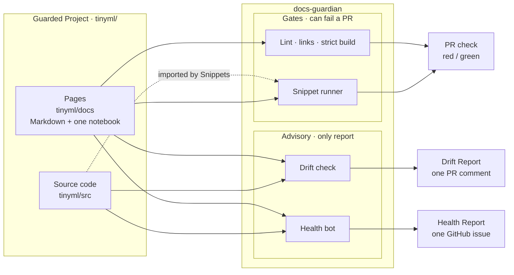
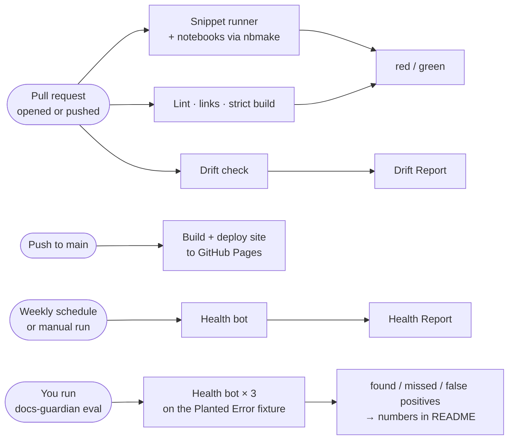
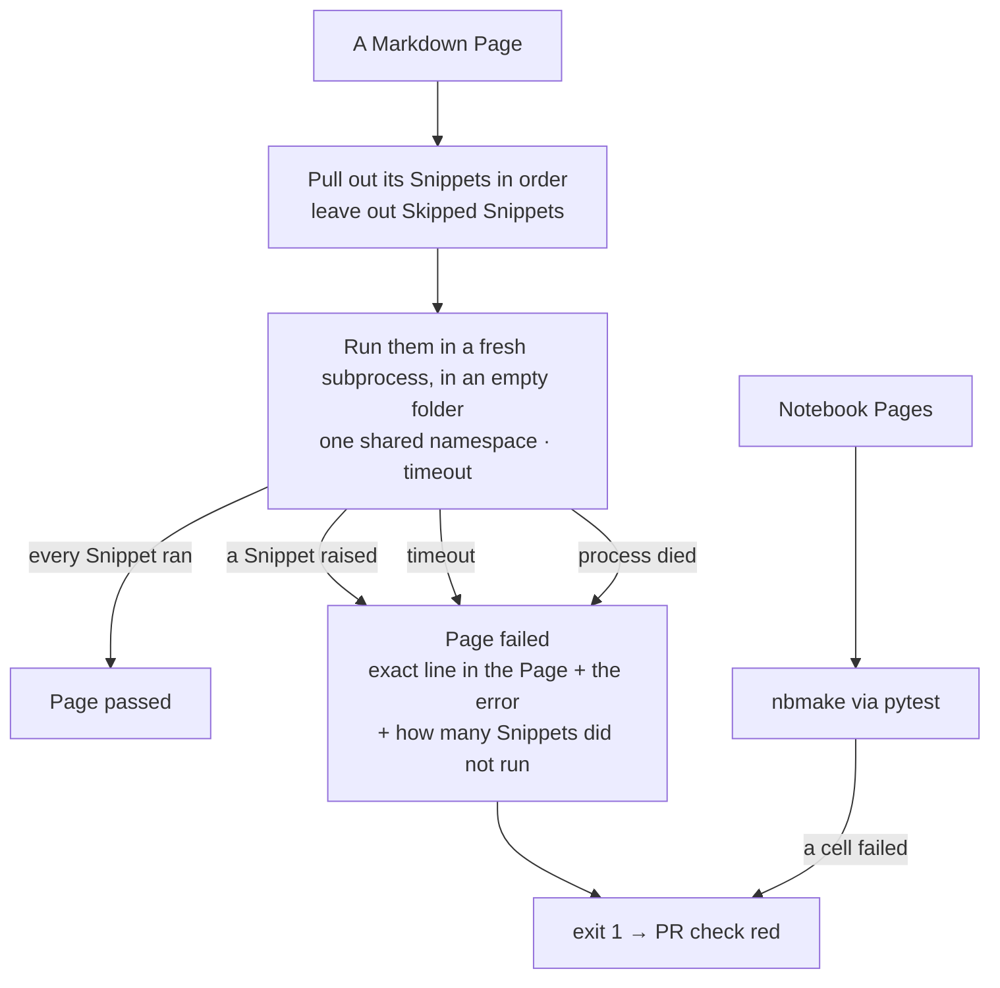
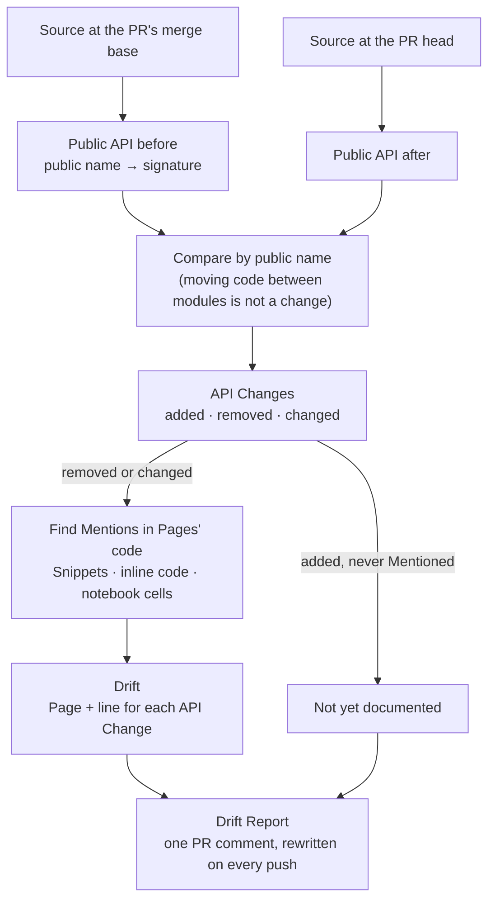
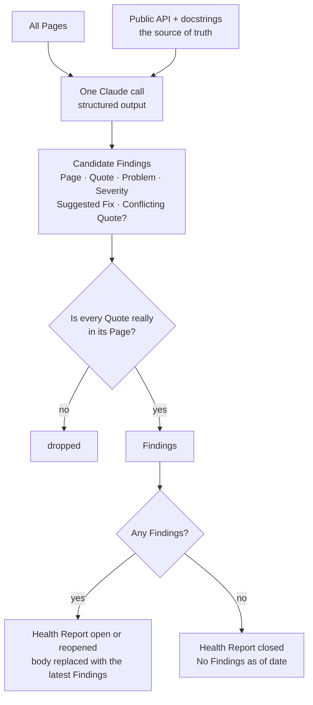

# How docs-guardian works

A visual walkthrough of the design. Terms in **bold** are defined in [`GLOSSARY.md`](../GLOSSARY.md); the reasoning behind the shape is in [`docs/adr/`](./adr/).

## 1. The big picture

docs-guardian watches a **Guarded Project** (tinyml: its source code and its **Pages**) and answers one question from several angles: *do the docs still match the code?* Two of its checks are **Gates** that can turn a pull request red; the other two are **Advisory** and only publish a report.



Each check catches a different kind of rot:

| Check | Kind | Catches | Can't catch |
| --- | --- | --- | --- |
| Snippet runner | Gate | Snippets and notebooks that no longer run | Code that runs but is described wrongly |
| Lint · links · strict build | Gate | Bad formatting, house-style violations, broken links, broken nav | Anything about meaning |
| Drift check | Advisory | Pages that Mention an API a PR removed or changed | Prose that names an API without code formatting |
| Health bot | Advisory | Explanations that no longer match behaviour; Pages contradicting each other | Nothing deterministic: it can miss and it can be wrong |

## 2. When each check runs

Fast, free checks run on every pull request. Anything slow or paid runs after merge, on a schedule, or by hand.



Next, if time allows (cut from the three-day scope): release notes from merged PRs, and an `llms.txt` index for AI assistants.

## 3. Inside each check

### Snippet runner (Gate)

Every Markdown Page runs on its own, in a fresh process group and an empty folder, so one Page can never make another pass or hang the whole run, and a Page passes only if it works from a reader's blank folder.



When the Page ends, by finishing, failing or timing out, every process it started is killed with it. Snippet output is discarded. Snippets are found by parsing the Page as CommonMark, the way a renderer does: fences inside lists and blockquotes count, fences inside HTML comments don't. A Snippet is skipped with `<!-- docs-guardian: skip -->` on the line above its fence. Run it with `docs-guardian snippets <docs-root>`; it exits 1 if any Page fails, and 2 if the folder holds no Pages, so a mistyped path cannot pass.

### Drift check (Advisory)

It compares the public API before and after the pull request, then finds where the Pages use anything that changed. The PR check stays green (ADR 0001).



A signature is the parameters, their defaults and annotations, and the return annotation; a name defined more than once keeps all its signatures. A class's signature is its own `__init__`. Known gaps: a class whose constructor comes from elsewhere (a dataclass, an inherited `__init__`) shows as `()`, and API defined in a private module (`_impl.py`) and re-exported is not seen. A top-level name is Mentioned on its own or after its package path (`tinyml.fit`), never as another object's attribute (`model.fit`).

Run it with `docs-guardian drift --base <branch> --source <dir> --docs <dir>`. It exits 0 whatever it finds; files the pull request leaves unreadable are listed in the report, not fatal; a mistyped base or folder exits 2. The workflow posts the report as one comment and rewrites it on every push (one run per pull request at a time); with no API Changes and no earlier report it posts nothing, and when GitHub's API fails (a fork's read-only token, an outage) it warns and the report stays in the job summary. The posting lives in `.github/scripts/post-drift-report.sh`, so its tests run the real script against a stub `gh`.

### Health bot (Advisory)

The language model reads the whole site at once, so it can also spot two Pages that disagree. Every claim it makes must point at real text, or it is thrown away.



Severity is **Wrong** (following the Page gives an error or a wrong result) or **Misleading** (the code works, the explanation doesn't match).

To measure the bot, `docs-guardian eval` runs it three times on a test Page holding five **Planted Errors** whose Quotes are known. It counts how many it found, how many it missed, and how many other things it flagged (false positives).

### Lint · links · strict build (Gate)

Mostly configuration; each runs as its own PR check.

| Tool | Catches |
| --- | --- |
| markdownlint-cli2 | Inconsistent headings, lists, whitespace |
| Vale + a `DocsGuardian` style | House-style violations, e.g. "Github" instead of "GitHub" |
| lychee | Broken internal and external links |
| `mkdocs build --strict` | Broken cross-references, Pages missing from the nav |

## 4. One change, every check

Say a pull request renames `fit_linear` to `fit` and doesn't touch the docs:

| Check | What you see |
| --- | --- |
| Snippet runner | Red: `quickstart.md:14  NameError: name 'fit_linear' is not defined`, plus how many Snippets did not run |
| Drift check | Drift Report: `fit_linear` removed, Mentioned in `quickstart.md:14` and `tutorial.md:31`; `fit` not yet documented |
| Lint · links · strict build | Green: the API pages are generated from docstrings, so nothing in the nav breaks |
| Health bot | Nothing yet. It runs on the next schedule, after merge, and the Gate stops this PR merging first |

## 5. Where things live

```text
docs-guardian/                  ← the repo
├── src/docs_guardian/          ← the tooling, one CLI: snippets · drift · health · eval
├── tests/
│   └── fixtures/planted/       ← the Planted Error test Page + expected Quotes
├── tinyml/                     ← the Guarded Project, self-contained
│   ├── src/tinyml/
│   ├── docs/                   ← its Pages (published to GitHub Pages)
│   └── mkdocs.yml
├── docs/                       ← docs-guardian's own docs (never published, never scanned)
│   ├── architecture.md         ← this page
│   └── adr/
├── .github/workflows/          ← one workflow per trigger
├── .github/scripts/            ← the drift check's comment poster
└── GLOSSARY.md
```
